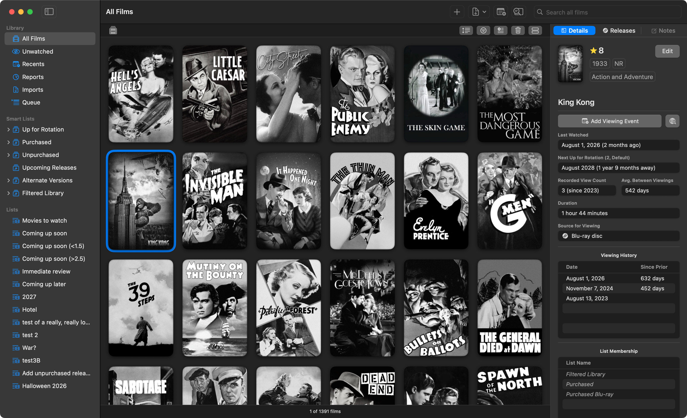

# Film Tracker

A macOS 15 application for metadata management regarding your personal film library.

- Track the films in your library, information about them, viewing rotation schedules, and your watch history.
- Create lists, search the database, queue titles for viewing.
- Catalog disc-based releases and your purchase history.
- View detailed statistics about your library over time.
- Export full backups of your database (automatically or manually) and produce PDF-based reports for sharing.
- Bulk-import film data from MP4 files using iTunes-style metadata and your ratings from Blu-ray.com.

In the "Documentation" folder you can find the complete user guide and search guide for reference.



## Installation

Film Tracker is not signed with an Apple Developer ID and is not notarized. To launch it, you can either disable Gatekeeper, remove the quarantine flag manually with the command below (using the appropriate path for your installation, of course), navigate to System Settings > Privacy & Security and click "Open Anyway" after first attempting a launch, or build it yourself with Xcode (open `Film Tracker.xcodeproj` in Xcode and choose Product > Build).

```sh
xattr -dr com.apple.quarantine "/Applications/Film Tracker.app"
```

## System Requirements and Security

- macOS 15.6.0 or later, Apple Silicon only.
- Sandboxed, uses Apple's Hardened Runtime, and is compliant with Swift 6 (Strict Concurrency and Strict Memory Safety); built against Xcode 26.3.
- If you choose to use the opt-in feature to add viewing events to your system calendar, Film Tracker will request "Full Calendar Access" through Apple's TCC system in order to enumerate the list of available calendars in the application and to write these events, nothing more. This is only necessary for this one feature.
- If you choose to use the opt-in feature to dispatch your "Up Next" Queue to the ATVQ application, Film Tracker will request "Local Network" access through Apple's TCC system to make this connection. This is only necessary for this one feature.

## Support

If you find a bug, please report it here on GitHub and I will try to fix it. If it affects macOS 15, I will try harder. Please be as thorough in your reporting as you can.

You're welcome to request features or changes if you're so-inclined, and I will give such requests due consideration, but just know that this application was built first and foremost for an audience of one and I consider it largely feature-complete at this time.

Film Tracker is available in English only, by design, and only supports the Gregorian calendar. I did not test this application with the light mode in macOS, so if something looks "off," use dark mode; it's better anyway.

## Note

I am not a software engineer; all of the code for this project was written by Anthropic's Claude models. That said, I use all of the applications under this account regularly in my daily life, so while they're not perfect, I'm confident in their efficacy and general reliability.

## License

Film Tracker is free software, licensed under the GNU General Public License, version 3 only (GPL-3.0-only). Copyright © 2026 avenged110. The full license text is in `COPYING`.
